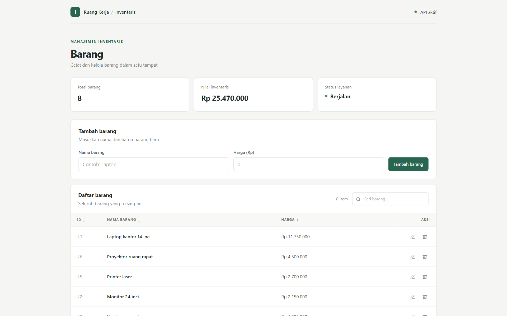
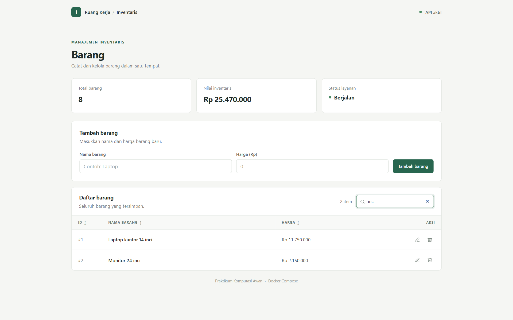
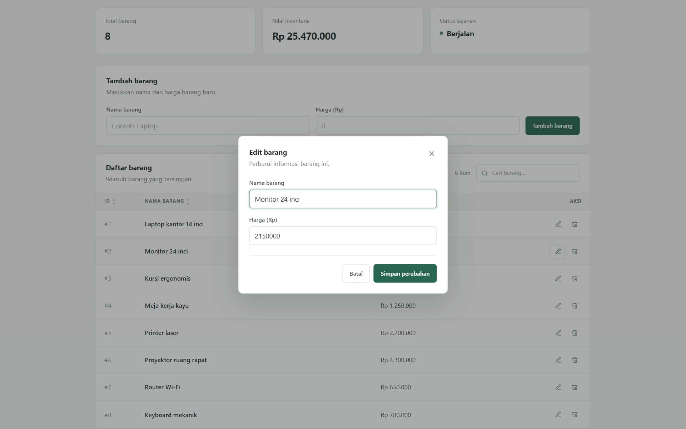
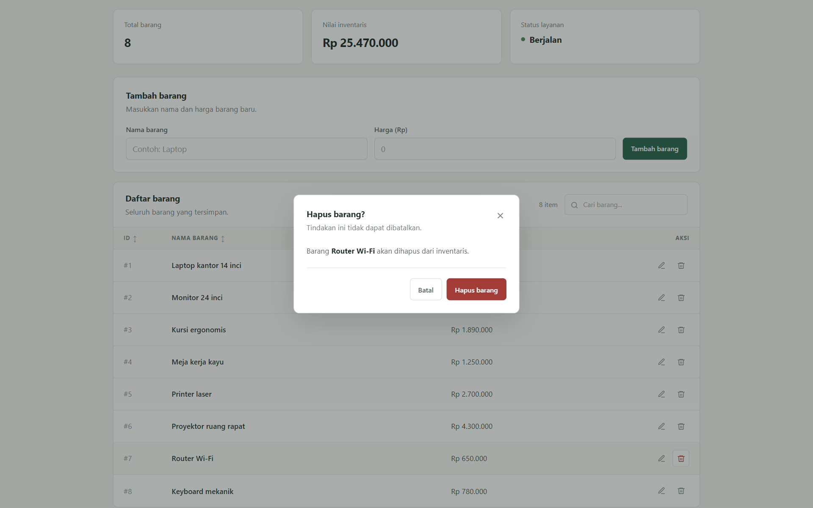
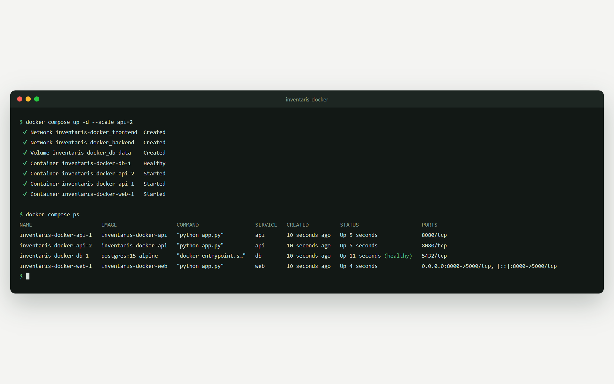

# Praktikum Komputasi Awan — Docker

Proyek ini merupakan implementasi praktikum Komputasi Awan yang mendemonstrasikan aplikasi inventaris multi-container dengan Docker Compose. Arsitektur terdiri dari web frontend, REST API, dan PostgreSQL.



**Preview statis:** [willyrafaelfs.github.io/Praktikum-Komputasi-Awan-Docker](https://willyrafaelfs.github.io/Praktikum-Komputasi-Awan-Docker/). Preview ini hanya menampilkan antarmuka tanpa backend dan data. Untuk mencoba fitur lengkap, jalankan aplikasi dengan Docker Compose (lihat [Menjalankan aplikasi](#menjalankan-aplikasi)).

## Repository

- **GitHub:** [willyrafaelfs/Praktikum-Komputasi-Awan-Docker](https://github.com/willyrafaelfs/praktikum-komputasi-awan-docker)
- **GitLab:** [willyrafaelfs/Praktikum-Komputasi-Awan-Docker](https://gitlab.com/willyrafaelfs/Praktikum-Komputasi-Awan-Docker)

Klon repository dari salah satu platform:

```bash
git clone https://github.com/willyrafaelfs/praktikum-komputasi-awan-docker.git
```

Atau gunakan mirror GitLab:

```bash
git clone https://gitlab.com/willyrafaelfs/Praktikum-Komputasi-Awan-Docker.git
```

## Fitur

- CRUD data inventaris (tambah, lihat, ubah, dan hapus).
- Pencarian realtime dan pengurutan kolom pada tabel.
- Ringkasan jumlah barang dan nilai inventaris.
- Pemisahan jaringan frontend dan backend; database tidak diekspos ke host.
- Healthcheck PostgreSQL dan volume untuk mempertahankan data.
- Mendukung scaling service API dengan Docker Compose.

## Tampilan

Semua screenshot memakai data contoh fiktif.

**Pencarian realtime:** tabel langsung tersaring saat mengetik, dan jumlah item ikut berubah.



**Edit barang:** data diubah lewat modal tanpa pindah halaman.



**Hapus barang:** penghapusan selalu meminta konfirmasi terlebih dahulu.



## Teknologi

- **Frontend:** Python 3.11, Flask (template Jinja), requests, CSS, dan JavaScript tanpa framework
- **API:** Python 3.11, Flask, dan Psycopg2
- **Database:** PostgreSQL 15
- **Container orchestration:** Docker dan Docker Compose
- **Preview statis:** GitHub Actions + GitHub Pages dan GitLab CI + GitLab Pages

Antarmuka menggunakan CSS lokal dan font sistem, sehingga styling tidak bergantung pada CDN eksternal. Frontend dirender di server; setelah menambah, mengubah, atau menghapus barang, halaman dialihkan kembali ke `/` (pola POST-redirect-GET) dan menampilkan notifikasi.

## Menjalankan aplikasi

### Prasyarat

- Docker Desktop atau Docker Engine yang aktif.
- Docker Compose v2 (`docker compose`).

### Jalankan

Dari direktori repository, bangun image dan jalankan seluruh service:

```bash
docker compose up -d --build
```

Periksa status container:

```bash
docker compose ps
```

Buka frontend di [http://localhost:8000](http://localhost:8000).

Untuk melihat log:

```bash
docker compose logs -f
```

### Menghentikan aplikasi

Hentikan dan hapus container serta network:

```bash
docker compose down
```

Volume database tetap tersimpan dan akan digunakan kembali saat aplikasi dijalankan lagi. Untuk menghapus volume beserta seluruh data inventaris, jalankan:

```bash
docker compose down -v
```

## Arsitektur

- `web` melayani antarmuka pada port `8000` di host dan berkomunikasi dengan API melalui network frontend.
- `api` menyediakan operasi inventaris pada port `8080` dan terhubung ke kedua network.
- `db` menggunakan PostgreSQL dan hanya terhubung ke network backend.
- API menunggu healthcheck database sebelum dijalankan.

Untuk menjalankan dua instance API:

```bash
docker compose up -d --scale api=2
```

Service `api` tidak memetakan port ke host, sehingga bisa dijalankan lebih dari satu instance tanpa bentrok port. Hasilnya: database berstatus healthy, dua instance API, dan web di port 8000.



## REST API

API hanya bisa diakses dari dalam network Docker (oleh service `web`), bukan dari host.

| Method | Endpoint | Fungsi |
|---|---|---|
| `GET` | `/barang` | Menampilkan semua barang |
| `POST` | `/barang` | Menambah barang (`{"nama": "...", "harga": 0}`) |
| `PUT` | `/barang/<id>` | Mengubah nama dan harga barang |
| `DELETE` | `/barang/<id>` | Menghapus barang |

`PUT` dan `DELETE` mengembalikan `404` bila barang tidak ditemukan. Semua query memakai parameter psycopg2, bukan string yang digabung langsung.
